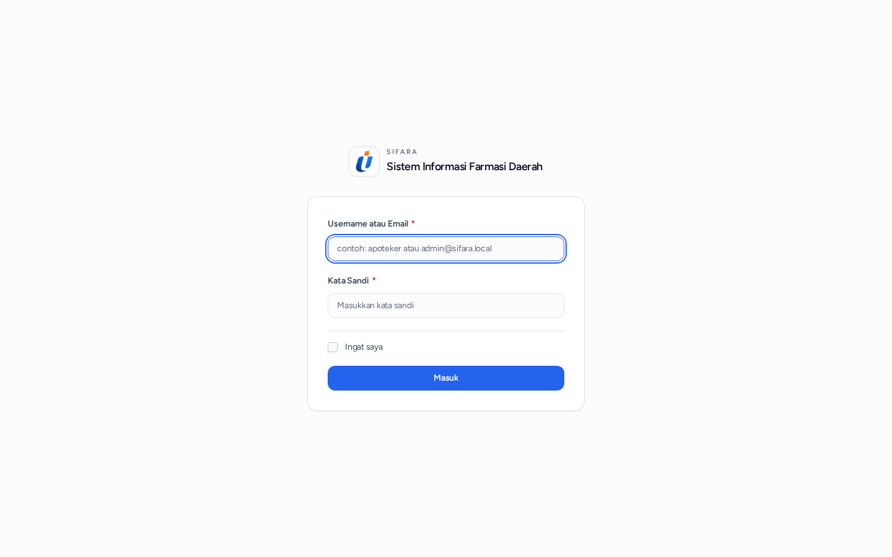
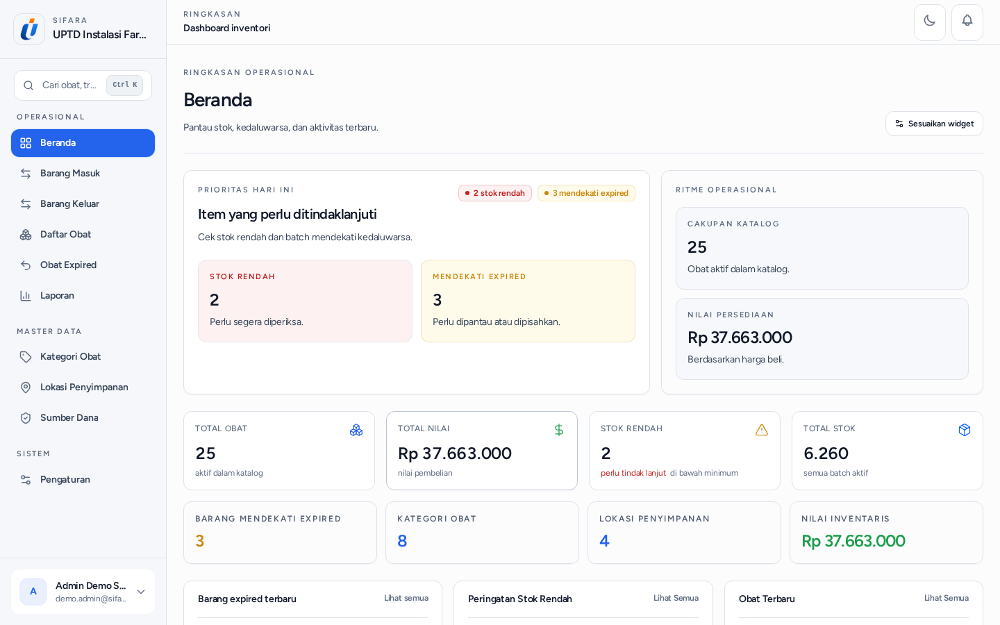
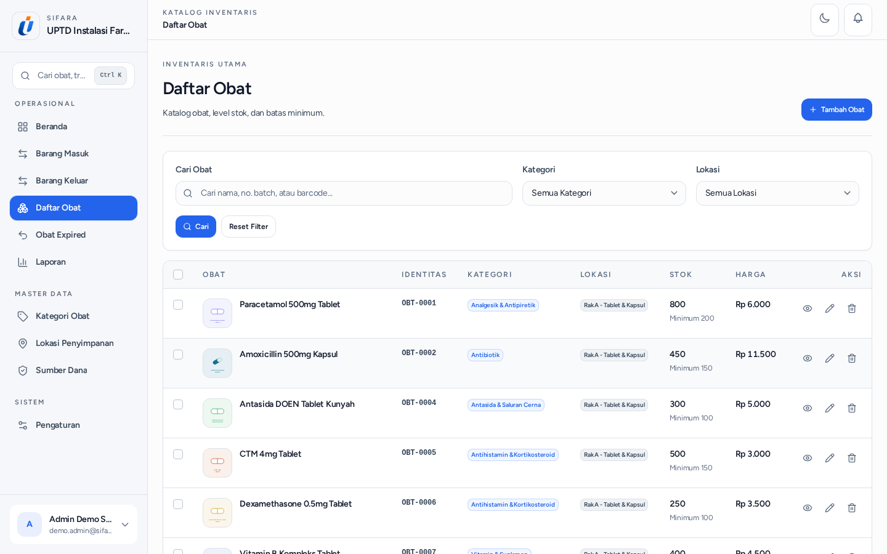
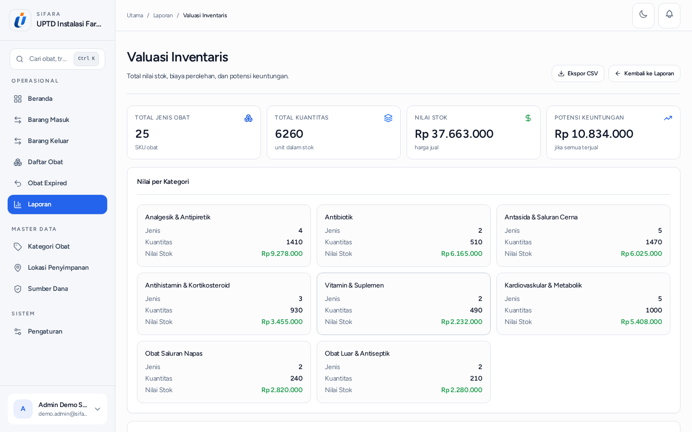

# SIFARA

**Sistem Informasi Farmasi Daerah**

## Ringkasan (Indonesia)

SIFARA adalah portofolio aplikasi pengelolaan persediaan obat untuk konteks **UPTD Instalasi Farmasi Daerah**. Fokusnya adalah membantu alur kerja farmasi daerah menjadi lebih tertata: katalog obat, penerimaan dan pergerakan stok, pemantauan batch serta kedaluwarsa, dan ringkasan nilai persediaan.

Portofolio ini memperlihatkan hasil desain produk dan pendekatan engineering tingkat tinggi. Source code aplikasi tetap private untuk melindungi konfigurasi, data pengembangan, dan detail implementasi yang bukan untuk distribusi publik.

Untuk walkthrough privat atau diskusi kebutuhan sistem, hubungi **m.noor.aditya.rahman@gmail.com**.

## English Summary

SIFARA (Regional Pharmacy Information System) is a portfolio case study for medicine-inventory operations in a local-government pharmacy setting. It presents product design and engineering practices around medicine catalogues, stock movement, batch and expiry monitoring, and inventory valuation.

The application source code remains private. This repository intentionally contains only sanitized portfolio material; private walkthrough requests can be made by email.

## Tampilan Produk

Semua tampilan berikut menggunakan data demo fiktif dan telah ditinjau sebelum dipublikasikan.

| Masuk | Dashboard |
| --- | --- |
|  |  |

| Katalog obat | Valuasi persediaan |
| --- | --- |
|  |  |

## Kapabilitas yang Ditampilkan

- Pengelolaan katalog obat dan informasi stok yang mudah ditelusuri.
- Pencatatan pergerakan persediaan untuk mendukung akuntabilitas operasional.
- Pemantauan batch, tanggal kedaluwarsa, dan status persediaan.
- Ringkasan nilai persediaan sebagai bahan evaluasi kebutuhan farmasi.
- Antarmuka yang dirancang untuk peran administrasi dan operasional.

## Pendekatan Engineering

- Aplikasi dibangun dengan Laravel, Vue, dan PostgreSQL.
- Validasi, otorisasi, dan audit perubahan diperlakukan sebagai bagian dari kebutuhan operasional.
- Pengembangan dilakukan secara iteratif dengan pengujian dan dokumentasi yang dapat ditinjau.
- Lihat [arsitektur konseptual](docs/architecture.id.md) dan [case study](docs/portfolio-case-study.id.md) untuk konteks lebih lanjut.

## Batas Publikasi

Repository ini bukan distribusi aplikasi dan tidak menyediakan akses ke source code, database, konfigurasi, kredensial, atau lingkungan demo aktif. Lihat [checklist publikasi](docs/demo-publication-checklist.md) dan [kebijakan keamanan](SECURITY.md) untuk detailnya.

## Inspirasi dan Atribusi

SIFARA terinspirasi dari [Inventoros](https://github.com/inventoros/inventoros). Identitas produk, alur inventaris farmasi, tampilan, dan materi portofolio SIFARA dikembangkan serta disesuaikan secara terpisah untuk kebutuhan manajemen persediaan farmasi daerah.

© 2026 Adeetz. Materi portofolio ini dilindungi hak cipta.
