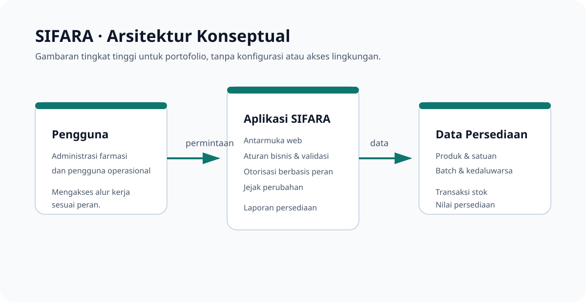

# Arsitektur Konseptual SIFARA

Diagram ini menjelaskan batas komponen SIFARA pada tingkat produk, bukan rancangan infrastruktur atau panduan implementasi.

1. **Pengguna** mengakses fitur sesuai peran operasional dan administrasinya.
2. **Aplikasi SIFARA** menyajikan antarmuka, menjalankan aturan bisnis dan validasi, menegakkan otorisasi, serta membentuk laporan.
3. **Data persediaan** menyimpan informasi produk, batch, tanggal kedaluwarsa, transaksi stok, dan nilai persediaan secara terstruktur.

Tidak ada hostname, alamat jaringan, konfigurasi container, detail basis data, maupun mekanisme akses lingkungan dalam dokumen ini. Detail tersebut tetap menjadi bagian dari lingkungan private.
